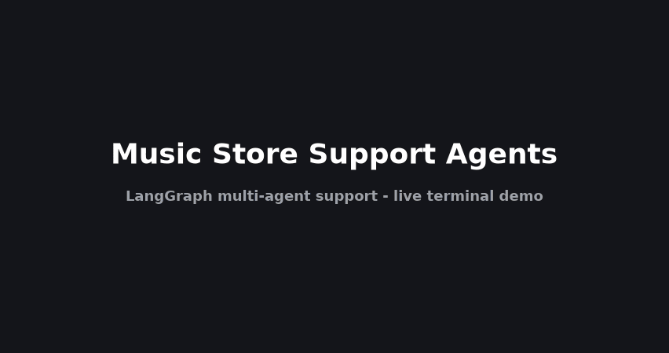
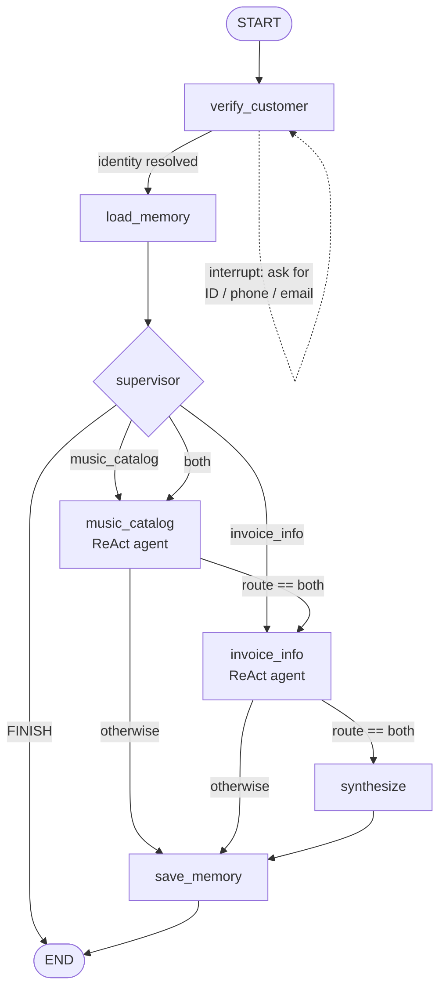

# Music Store Support Agents

A multi-agent customer support assistant for a digital music store, built with **LangGraph** and **LangChain**, backed by the [Chinook](https://github.com/lerocha/chinook-database) SQLite database.

A supervisor agent routes each message to a music-catalog specialist, an invoice specialist, or both. The workflow verifies the caller's identity before any account data is read, personalises recommendations from long-term memory, and pauses mid-conversation to ask for credentials or missing details — resuming exactly where it stopped.

[](https://github.com/AliYasser27/music-store-support-agents/actions/workflows/ci.yml)


---

## Demo



Three moments from a live session, in the order they appear:

1. **Unverified request.** The customer asks about a purchase and Rolling Stones albums without credentials. `verify_customer` resolves nothing, so the graph interrupts and asks for a Customer ID, phone, or email.
2. **Verified request.** The phone number resolves to a Chinook customer, the supervisor routes to `both`, and the merged answer contains the most recent invoice amount and the matching albums.
3. **Memory recall.** The follow-up — *"List some songs that match my preferences?"* — names no artist. The music specialist answers from the preference summary saved at the end of the previous turn.

The GIF is a 75-second cut. [Watch the full 9-minute walkthrough](https://github.com/AliYasser27/music-store-support-agents/releases/download/demo-v1/music-store-support-agents.mp4) (MP4, 30 MB).

---

## What it does

| Capability | Implementation |
|---|---|
| **Identity verification** | Accepts a customer ID, email, or phone number; normalises phone formats and resolves it against `Customer` before any account data is read. |
| **Supervisor routing** | Pydantic-typed structured output choosing `music_catalog`, `invoice_info`, `both`, or `FINISH` per message. |
| **Music specialist** | ReAct agent with four catalog tools (albums, tracks, genre, song search), bound to real SQL queries. |
| **Invoice specialist** | ReAct agent with three tools (invoices by date, line items by price, support rep for an invoice), scoped to the verified customer. |
| **Human in the loop** | `interrupt()` / `Command(resume=...)` for missing credentials *and* missing tool arguments, with state preserved across pauses by a checkpointer. |
| **Long-term memory** | Per-customer preference summary in an `InMemoryStore`, written by a structured-output extraction step at the end of each turn and injected into both specialists' prompts. |
| **Short-term memory** | `customer_id` and full message history keyed by `thread_id`, so nothing is re-asked within a session. |

---

## Architecture



<details>
<summary><strong>Node responsibilities</strong></summary>

- **`verify_customer`** — extracts an identity from the latest message and resolves it to a `CustomerId`. Loops on an interrupt until it succeeds.
- **`load_memory`** — reads the customer's stored preference summary into `loaded_memory`.
- **`supervisor`** — one structured LLM call. Returns a route plus a one-sentence justification, which is logged.
- **`music_catalog` / `invoice_info`** — prebuilt ReAct agents, each with its own tools and prompt.
- **`synthesize`** — only on the `both` route: merges the two answers into one reply. Best-effort; if it fails, the individual answers stand.
- **`save_memory`** — extracts durable preferences from the recent turns and updates the store.

</details>

Deeper notes — state schema, turn-by-turn trace of a `both` request, and failure behaviour — are in [`docs/architecture.md`](docs/architecture.md).

---

## Quickstart

**Requires:** Python 3.10+ and internet access on first run (the Chinook script is downloaded once per process and loaded into memory — there is no database to install).

```bash
git clone https://github.com/AliYasser27/music-store-support-agents.git
cd music-store-support-agents

python -m venv .venv
source .venv/bin/activate          # Windows: .venv\Scripts\activate

pip install -r requirements-dev.txt    # runtime + notebook, ruff and pytest
# runtime only: pip install -r requirements.txt

cp .env.example .env                   # then set GROQ_API_KEY
```

Get a free key at [console.groq.com/keys](https://console.groq.com/keys). The system uses Groq because it is free to evaluate and fast enough for multi-agent tool loops.

### Run the scripted scenarios

```bash
python -m src.run --demo
```

This runs the two acceptance scenarios without manual input and prints the routing decisions alongside the answers.

### Chat interactively

```bash
python -m src.run
```

Type `quit` to exit. Reuse `--thread my-session` to resume a named session.

### Run the notebook

```bash
jupyter lab music_store_customer_support.ipynb
```

The notebook is a guided walkthrough: it inspects the database and graph, exercises the tools, and drives both scenarios with explanations between steps.

### Tests

```bash
pytest -m "not e2e"    # offline: tools, verification, memory, HITL, graph wiring
pytest                 # adds the live-LLM scenarios (needs GROQ_API_KEY)
```

---

## Testing approach

The suite is split by what it needs, so CI never depends on a paid or rate-limited API:

| Suite | Covers | Needs API key |
|---|---|---|
| `test_tools.py` | Every SQL tool against real Chinook data, sort order, cross-customer isolation, SQL-injection safety | No |
| `test_verification.py` | ID / email / phone resolution, normalisation, unknown identities | No |
| `test_memory.py` | Per-customer preference isolation and default behaviour | No |
| `test_hitl.py` | `interrupt()` → `Command(resume=...)` contract in a minimal graph | No |
| `test_graph_structure.py` | Node/edge wiring, conditional routing, import without credentials | No |
| `test_e2e.py` | The two acceptance scenarios end to end (marked `e2e`) | Yes |

LLM clients are created lazily, so importing the graph and building it in CI costs nothing. That is deliberately what `test_graph_builds_without_api_key` protects.

---

## Design decisions

**Supervisor as a router, not an answerer.** The supervisor only classifies; it never sees the tools. That keeps the routing prompt small and makes a wrong route a one-line fix rather than a prompt rewrite.

**`both` is an explicit route, not an agent loop.** When a message needs two specialists, the graph runs them in a fixed order and merges the results, so latency and failure mode are predictable — no agent deciding when another agent is "done".

**Interrupts live inside the tools.** Missing arguments are a tool-level concern, so the tool asks for what it needs and the resumed value becomes the argument. The alternative — pre-validating every argument in the supervisor — would duplicate each tool's signature in the prompt.

**The verified ID is passed, never re-asked.** The invoice prompt contains the resolved `CustomerId`, and the employee-lookup query filters on it too. A customer cannot read another customer's support-rep details by guessing an invoice number.

**Bound parameters everywhere.** Every query is a SQLAlchemy `text()` statement with `:named` parameters. `test_artist_name_cannot_inject_sql` asserts it.

**Failures degrade instead of crashing.** Routing falls back to `FINISH`, synthesis falls back to the two separate answers, and memory extraction is skipped on error — each logged at `WARNING`. A support bot that drops a turn is worse than one that answers slightly worse.

---

## Project structure

```
music-store-support-agents/
├── src/
│   ├── config.py            # env-driven settings (single source of configuration)
│   ├── db.py                # Chinook download + in-memory SQLite engine
│   ├── llm.py               # cached ChatGroq factory
│   ├── state.py             # shared graph state schema
│   ├── graph.py             # node wiring, conditional edges, compiled graph
│   ├── run.py               # CLI: scripted demo and interactive session
│   ├── agents/              # supervisor + two ReAct specialists
│   ├── nodes/               # verification, memory, HITL prompt helpers
│   └── tools/               # music and invoice SQL tools
├── tests/                   # offline suite + gated e2e suite
├── docs/                    # architecture notes and demo assets
├── music_store_customer_support.ipynb
├── Makefile                 # make setup / lint / test / demo
└── .github/workflows/ci.yml # ruff + offline tests on every push
```

`make help` lists the available targets.

---

## Configuration

All settings are optional except the API key. See `.env.example`.

| Variable | Default | Purpose |
|---|---|---|
| `GROQ_API_KEY` | — | **Required.** Groq API key. |
| `MODEL_NAME` | `llama-3.3-70b-versatile` | Any Groq model that supports tool calling. |
| `CHINOOK_SQL_URL` | official Chinook SQL script | Override to use a local mirror. |
| `CHINOOK_HTTP_TIMEOUT` | `30` | Download timeout in seconds. |

---

## Limitations and next steps

This is a reference implementation, and the honest list of what it is *not*:

- **Memory is process-local.** `InMemorySaver` and `InMemoryStore` lose everything on restart. Production would use the Postgres checkpointer and store, keyed by customer rather than thread.
- **Identity verification is weak.** Knowing a customer's phone number is not authentication. A real deployment needs a one-time code or session token, and audit logging on every lookup.
- **Phone matching is heuristic.** It normalises separators and compares the last nine digits; unusual international formats may not resolve.
- **No evaluation harness.** Routing accuracy is currently judged by the e2e tests, not measured over a labelled set. A small prompt-regression suite with per-route assertions is the obvious next step.
- **The database is re-downloaded per process.** Fine for a demo, wasteful for anything deployed; the data should be baked into the image.
- **LLM calls are not traced.** Adding LangSmith (or OpenTelemetry) tracing would make routing quality and latency observable per turn.

---

## Context

Built as the final project of a GenAI engineering course, then hardened for use as a portfolio piece: lazy client construction, a CI pipeline that runs without credentials, tests for the interrupt/resume contract, and the documentation above. The original project brief is summarised in [`docs/architecture.md`](docs/architecture.md#project-brief).

## Acknowledgments

- [Chinook sample database](https://github.com/lerocha/chinook-database) (MIT) for the data model and SQL script.
- The LangGraph team for the `interrupt`, checkpointer, and store primitives this project is built on.

## License

MIT — see [LICENSE](LICENSE).
